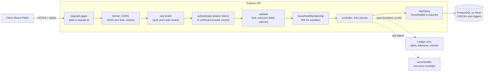
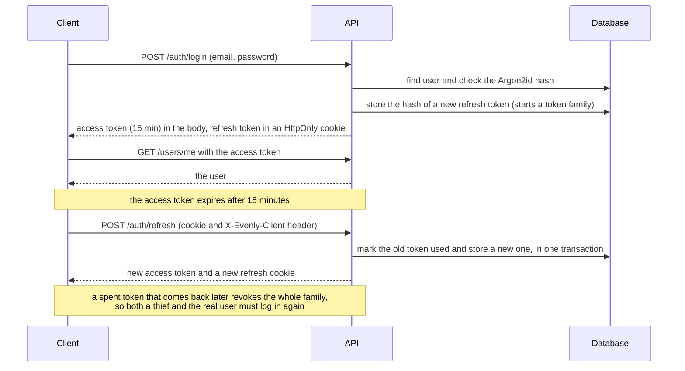
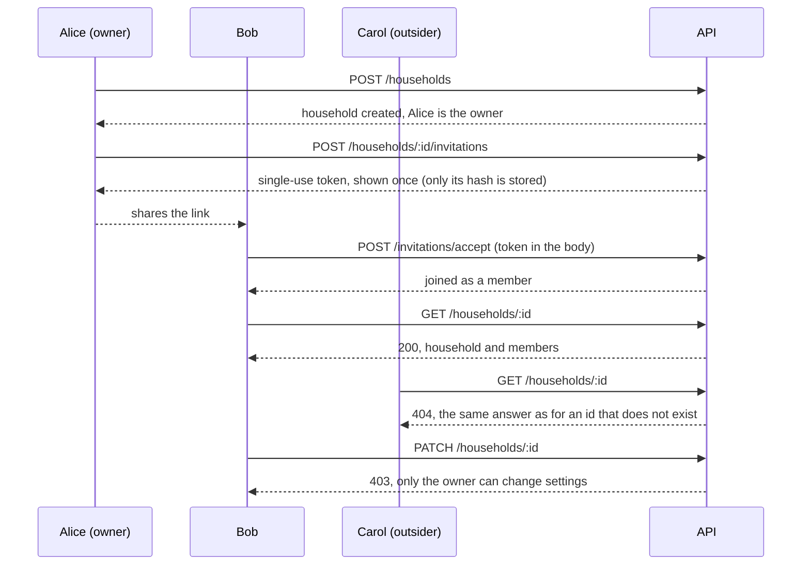
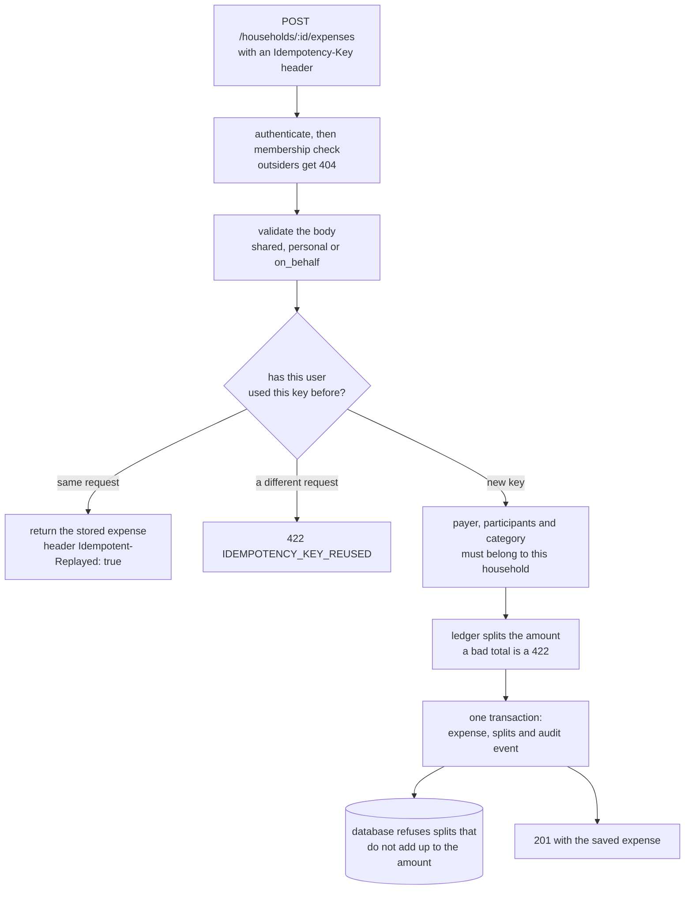
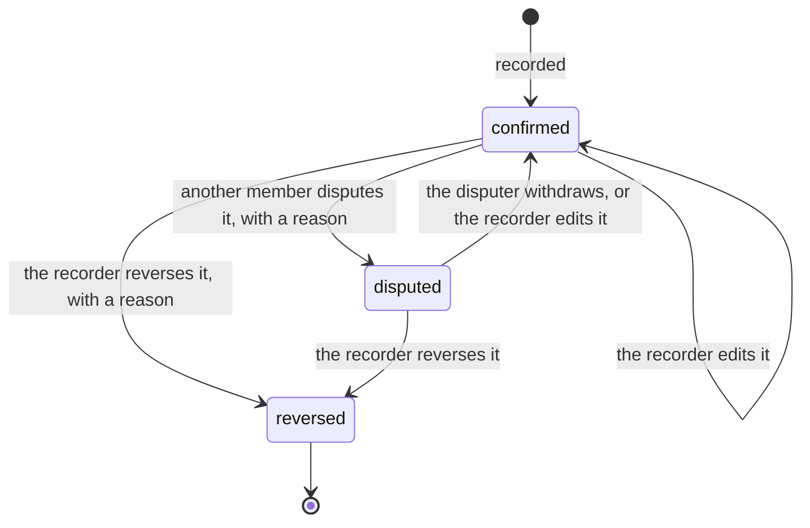
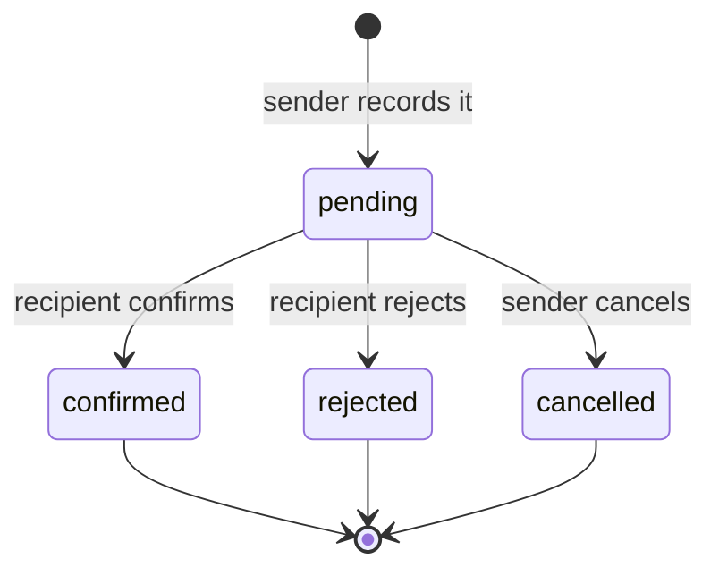
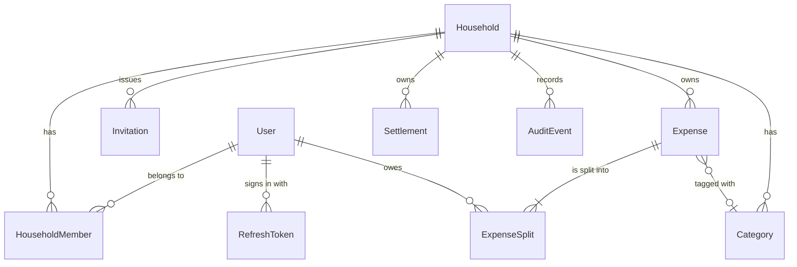

# Evenly

Shared-expense tracker for roommates. Every balance is computed from recorded transactions and can be explained down to the individual expense.

**Engineered by [Sahil Sameer Siddique](https://www.linkedin.com/in/sahil-sameer-siddique/)** · [LinkedIn](https://www.linkedin.com/in/sahil-sameer-siddique/)

> **Status:** early development, not deployed. Part 1 is done: the money engine, database, authentication and households (with tenant isolation) are built and tested. Part 2 is under way: the expense API is complete (create, read, edit, reverse, refund, dispute, history). Settlements, balances and the app UI are next. See [the plan](docs/PLAN.md) and the [dev log](docs/DEVLOG.md).

## Principles

- **Ledger first, expense tracker second, AI third.** Deterministic code decides the money; AI (later) only drafts, and a human confirms.
- **Integer paise only.** No floats anywhere in money logic.
- **Balances are never stored.** They are recomputed from confirmed expenses and repayments, and always sum to zero.
- **Append-only history.** Corrections are reversals, never deletes.
- **The database defends the ledger.** CHECK constraints, a split-sum trigger and an append-only audit trigger refuse bad data even if application code regresses.
- **A household's data is never visible to outsiders.** Membership is checked on every household route, and outsiders get the same 404 as for an id that does not exist.

## What works today

| Area | State |
|---|---|
| Ledger core (`server/src/ledger`) | Money parsing, one largest-remainder split rule with a fair hash tie-break, balances, settlement suggestions, refunds. Property-tested over 10,000 random ledgers per property. |
| Database | Prisma schema (users, households, expenses, splits, settlements, audit events, refresh tokens), migrations including the hand-written guards, seed script. |
| Authentication | Register, login, 15-minute access tokens, rotating refresh-token cookie with reuse detection, logout, password change, rate limiting, CSRF guard. Details in [SECURITY.md](docs/SECURITY.md). |
| Households | Create, list, view, change settings (owner only), single-use invitation links, leave (blocked while a balance is outstanding). Every household route checks membership, and outsiders get 404. See [ADR 003](docs/ADR/003-tenancy-and-authz.md). |
| API plumbing | Request ids, structured logs, one response/error envelope, Zod validation on every input. |
| Expenses | Create shared (equal, exact, percentage or weighted split), personal (private to its creator) and on-behalf expenses. Retries are safe: an `Idempotency-Key` makes a double tap create exactly one expense. List with filters and cursor pagination, and detail by id. Every create writes the expense, its splits and an audit event in one transaction. See [ADR 004](docs/ADR/004-idempotency-strategy.md). |
| Expense corrections | Edit (guarded by a version, so two simultaneous edits cannot overwrite each other), reverse (the row is kept and balances update), partial refunds shared back pro rata, disputes with a reason, and a per-expense history from the audit trail. Only the person who recorded an expense can edit or reverse it. See [ADR 006](docs/ADR/006-expense-lifecycle.md). |
| Repayments and balances | Record a repayment (pending until the person being paid confirms it; they can also reject it, and the sender can cancel). Balances, a chronological ledger with every member's running balance, and settlement suggestions are all computed from the stored records, never stored. Creating an expense or confirming a repayment returns `balanceAfter`, and the books are re-checked after every money-changing write. Leaving is blocked while a repayment is pending. See [ADR 007](docs/ADR/007-settlements-and-balances.md). |
| Settling up | A Settle screen: who owes whom, record a repayment, confirm, reject or cancel one, a "how it is calculated" breakdown with every ledger entry, and the repayment history. On an expense: edit (safe against two people editing at once), reverse, dispute and withdraw, each with a reason where it matters, plus a history of every change. The owner can rename the household. The app has a home-screen manifest and icons. |
| Sign in and sign up | One card for `/login` and `/register`: on wide screens a panel slides between the two forms, on phones one form at a time. Fields have icons and placeholders, the password can be shown or hidden, and the sign-up form shows a live password hint. |
| Landing page | A public front page at `/` for signed-out visitors: what Evenly is, how it works, a worked example, questions, and Get started and Log in. Static, with no images or animation. |
| Client | Sign up, log in (the session survives a reload), create a household, invite a roommate by single-use link, accept an invitation, see members, switch theme. Overview with your balance in words, an Add-expense flow (on-screen keypad on phones, four split methods with a live preview, review, safe retries, Undo), an expenses list with search, filters and infinite scroll, and an expense detail with the split. Responsive from 320 px phones to large monitors: a bottom bar on phones, an icon sidebar on tablets, a labelled sidebar on desktop. The design is written up in [DESIGN.md](docs/DESIGN.md). Repayments and the Settle screen are next. |

## How a request is handled

Every request passes through the same pipeline. A household route stops at the first check that fails, and never reaches the database if it does.



## Signing in and staying signed in

The access token is short-lived and lives only in client memory. The refresh token is an unguessable random value kept in an `HttpOnly` cookie, and only its hash is stored. Each refresh replaces it.



## Households and invitations

Alice creates a household and invites Bob with a single-use link. Carol is not a member, so she learns nothing about the household, not even that it exists.



## Recording an expense

Retrying is always safe. The client makes an `Idempotency-Key` when the form opens, so a double tap or a dropped connection cannot create two rent payments.



## Life of an expense

An expense is never deleted. It changes status, and every change is written to the audit trail with who did it and why. Disputed expenses still count in balances; reversed ones do not.



## Life of a repayment

A repayment moves no money in the app; it is a claim until the person being paid agrees it arrived. Only confirmed repayments change balances.



Worked example through the API: Alice pays 2000 and 600 and Bob pays 1200 and 800 (all shared equally), so Alice is owed ₹300 and Bob owes ₹300 (`30000` paise). A pending repayment changes nothing. When Alice confirms Bob's ₹200 it becomes ₹100 / −₹100. Paying ₹400 instead flips it to −₹100 / ₹100.

## Data model

Every row that belongs to a household carries its `householdId`. Money is stored as integer paise.



## API so far (`/api/v1`)

| Method | Path | Purpose |
|---|---|---|
| POST | `/auth/register` | Create an account |
| POST | `/auth/login` | Log in; returns an access token and sets the refresh cookie |
| POST | `/auth/refresh` | Rotate the refresh token (needs `X-Evenly-Client: web`) |
| POST | `/auth/logout` | End this device's session (needs `X-Evenly-Client: web`) |
| POST | `/auth/change-password` | Change password and sign out other devices |
| GET | `/users/me` | The current user |
| POST | `/households` | Create a household (you become the owner) |
| GET | `/households` | Households you belong to |
| GET | `/households/:householdId` | One household and its members (members only, else 404) |
| PATCH | `/households/:householdId` | Change name, timezone or default split (owner only) |
| POST | `/households/:householdId/invitations` | Create a single-use invitation link (owner only) |
| POST | `/invitations/accept` | Join a household with an invitation token |
| POST | `/households/:householdId/leave` | Leave (balance must be zero; an owner names a successor) |
| POST | `/households/:householdId/expenses` | Record an expense (needs an `Idempotency-Key` header) |
| GET | `/households/:householdId/expenses` | List expenses: filters `from`, `to`, `categoryId`, `paidById`, `type`, `status`, `q`; `limit` and `cursor` for pages |
| GET | `/households/:householdId/expenses/:expenseId` | One expense with its splits (404 if it is someone else's personal expense) |
| PATCH | `/households/:householdId/expenses/:expenseId` | Edit; send the whole expense plus the `version` you saw (409 if it changed) |
| POST | `/households/:householdId/expenses/:expenseId/reverse` | Reverse with a reason (the person who recorded it) |
| POST | `/households/:householdId/expenses/:expenseId/dispute` | Dispute with a reason (any other member) |
| POST | `/households/:householdId/expenses/:expenseId/dispute/withdraw` | Withdraw a dispute (the person who raised it) |
| POST | `/households/:householdId/expenses/:expenseId/refunds` | Record a partial or full refund (needs an `Idempotency-Key`) |
| GET | `/households/:householdId/expenses/:expenseId/history` | Every change to the expense, who made it and why |
| POST | `/households/:householdId/settlements` | Record a repayment to another member (needs an `Idempotency-Key`); starts pending |
| GET | `/households/:householdId/settlements` | Repayment history: filter `status`; `limit` and `cursor` for pages |
| GET | `/households/:householdId/settlements/:settlementId` | One repayment |
| POST | `/households/:householdId/settlements/:settlementId/confirm` | Confirm (the person being paid); returns `balanceAfter` |
| POST | `/households/:householdId/settlements/:settlementId/reject` | Reject with an optional reason (the person being paid) |
| POST | `/households/:householdId/settlements/:settlementId/cancel` | Cancel while pending (the sender) |
| GET | `/households/:householdId/balances` | Each member's net balance and its parts (paid, share, sent, received) |
| GET | `/households/:householdId/ledger` | Every entry oldest first with each member's running balance |
| GET | `/households/:householdId/settlement-suggestions` | Who should pay whom to clear everything (advice only) |

`GET /health` and `GET /ready` are the liveness and database checks.

## Stack

| Layer | Choice |
|---|---|
| Client | React 19 with the React Compiler, Vite, Tailwind CSS 4, React Router, TanStack Query, Vitest |
| Server | Node.js, Express 5 (JavaScript, ES modules), Zod |
| Database | PostgreSQL on Neon, via Prisma 7 |
| Auth | Argon2id, `jose` (JWT), opaque hashed refresh tokens |
| Logging | Pino |
| Tests | Vitest, fast-check, Supertest (Playwright planned) |

## Repository layout

```
client/   React PWA
server/   Express API; server/src/ledger is the pure money engine
docs/     PRD, plan, ledger rules, security, ADRs, dev log
```

## Docs

- [PRD](docs/PRD.md): problem, users, MVP scope, non-goals
- [Plan](docs/PLAN.md): phased roadmap and progress
- [Ledger](docs/LEDGER.md): formulas, algorithms, invariants
- [Security](docs/SECURITY.md): what is enforced, known limits
- [Folder structure](docs/FOLDER.md): layout, built and planned
- [Decisions (ADRs)](docs/ADR): money representation, database, tenancy, idempotency, cookie sessions, expense lifecycle
- [Dev log](docs/DEVLOG.md): weekly progress

## Setup

Developed on Node 24. You also need a free [Neon](https://neon.tech) project.

```bash
cd server
npm install
cp .env.example .env
```

Fill in `server/.env`:

| Variable | What |
|---|---|
| `DATABASE_URL` | Neon pooled connection string (used by the app) |
| `DIRECT_URL` | Neon direct connection string (used by migrations) |
| `JWT_ACCESS_SECRET` | 32+ random characters. Generate: `node -e "console.log(require('crypto').randomBytes(48).toString('base64url'))"` |
| `CLIENT_ORIGIN` | Optional, defaults to `http://localhost:5173` |
| `TEST_DATABASE_URL` | Pooled string of a **separate** Neon branch, for tests only |
| `TEST_DIRECT_URL` | Optional: direct string for that same test branch, used for the run lock (worked out from the line above if missing) |

Create the tables and generate the Prisma client, then start the API:

```bash
npx prisma migrate deploy
npx prisma generate
npm run seed        # optional: a demo household
npm run dev
```

Run `npx prisma generate` again after any schema change or `npm install`, or the client will not know about new tables.

Run the client with the server already running: `cd client && npm install && npm run dev`. Vite forwards `/api` to the server on port 5000, so the browser only talks to one origin. Client tests: `cd client && npm test`.

## Tests

```bash
cd server
npm test
```

Most tests need no database. The `*.db.test.js` tests (authorization, invitations, sessions and the end-to-end Part 1 gate) run against `TEST_DATABASE_URL`, are skipped without it, and wipe every table in that database, so it must be a separate Neon branch. Because they share that one database, Vitest runs on a single worker, one test file at a time. A run also takes a lock on the test database for its whole duration, so starting a second `npm test` while one is running stops straight away with a clear message instead of wiping the first run's data. The remote database makes every query cost about 80 ms, so the shared test setup (`makeWorld` in `server/src/test/factories.js`) builds a whole household in one SQL statement.

Create the test branch as a **schema-only** copy of your dev branch, then mark its migrations as applied:

```bash
npx prisma migrate resolve --applied <migration-name>   # once per migration, with DIRECT_URL pointing at the test branch
```

Or point `DIRECT_URL` at an empty test branch and run `npx prisma migrate deploy`.

---

Engineered by **[Sahil Sameer Siddique](https://www.linkedin.com/in/sahil-sameer-siddique/)** · [Connect on LinkedIn](https://www.linkedin.com/in/sahil-sameer-siddique/)
